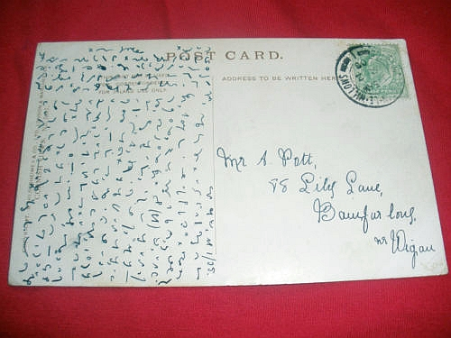
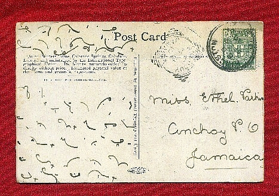
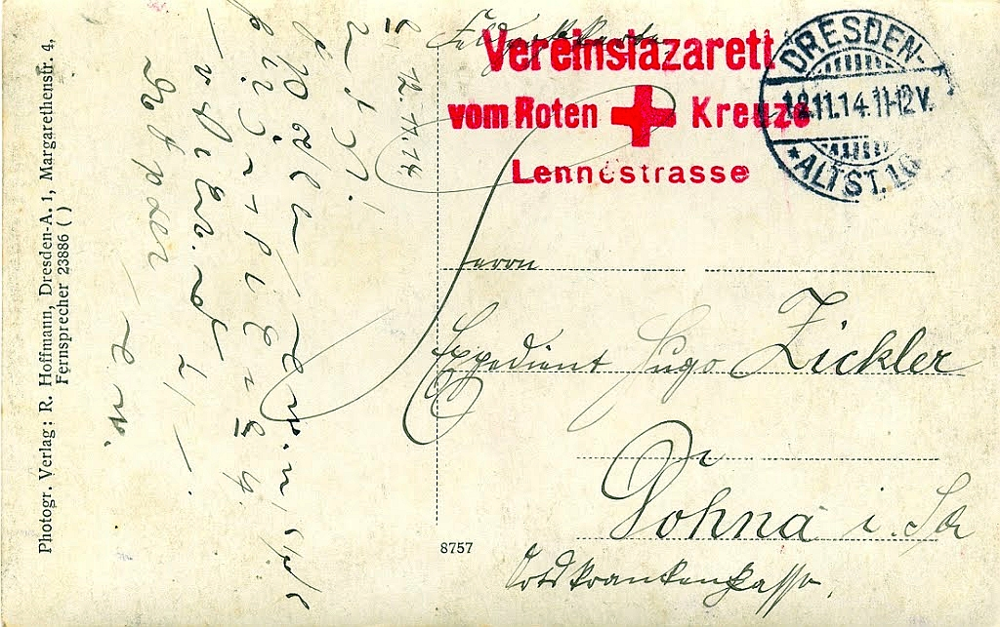
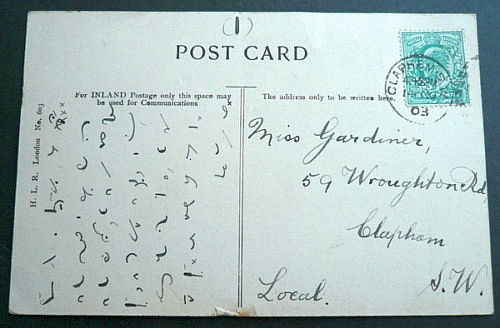
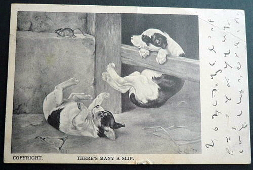
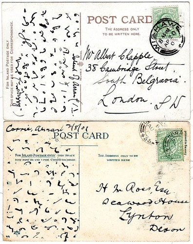

Kiedyś już chyba o tym pisałem. Ale przybyło mi w kolekcji linków, więc
aktualizuję. O powszechności stosowania stenografii warto pisać przy
każdej okazji. Tajemna sztuka szybkiego pisania w krajach cywilizowanych
naprawdę dotyczyła większości wykształconej warstwy społeczeństwa. Nie
dotyczyło to Polski, o czym coraz lepiej się przekonuję czytając
historyczne materiały źródłowe, tj. sprawozdania z kongresów
stenograficznych, gdzie wciąż narzeka się na brak zainteresowania wśród
Polaków, na niechęć władz do wspierania stenografii... Tymczasem za
miedzą, po lewej i prawej, a także na dole i górze, stenografia
zdobywała wciąż nowych zwolenników. Jest to z pewnością towar podobny do
komputera: nie możesz się przekonać o jego wartości (roboczej,
rozrywkowej oraz innej), zanim sobie takiego nie sprawisz. Zanim go
sobie nie sprawisz, świetnie sobie radzisz bez niego. Ale kiedy już go
sobie sprawisz, nie potrafisz zrozumieć, jak mogłeś bez niego żyć.

<!--  [{width="320" height="203"}]({filename}/wp-images/uploads/2012/03/villetrieste.jpg)
  pozdrowienia z Triestu -->



--------------------

### *Dopisek 2026-02-13:*

Tę pocztówkę (za podpowiedzią znajomego) jako pierwszą dałem do przetłumaczenia do algorytmu [Grok](https://grok.com/). Oto poniżej zapis naszej krótkiej konwersacji:

--------------------

*W takim razie spróbuj przełożyć tekst z tej pocztówki (prawdodpodobnie po niemiecku systemem Gabelsbergera):*

--------------------

Transkrypcja (najbardziej prawdopodobna wersja):  
Triest, den 10. 8. 37 [lub 10.8.97 / 10.8.07 – data niepewna, ale najprawdopodobniej 10 sierpnia 1937 lub 1897]  
Lieber / Liebe [coś]  
herzlichen Gruß aus Triest!  
Wir sind hier im Hotel de la Ville sehr gut aufgehoben. Das Wetter ist herrlich, die Stadt sehr schön und interessant. Gestern waren wir in Opčine [Opicina] und haben eine wunderschöne Aussicht gehabt.  
Heute fahren wir nach Muggia [lub Miramare – nie do końca czytelne].  
Viele herzliche Grüße sendet  
Deine / Ihr  
[imię – wygląda na Berta lub Bertha / Grete / Herta – niepewne]  
[ostatnia linijka – prawdopodobnie podpis + dopisek]  
[coś] herzlichen Dank für Deinen lieben Brief  
Typowe zwroty i słowa, które pasują do kształtu kresek (z dużą dozą prawdopodobieństwa):  

aus Triest / in Triest  
sehr gut  
Wetter herrlich  
Stadt schön  
Aussicht  
Gruß / herzliche Grüße  
Deine / Dein  
  
Największe wątpliwości budzą:  
  
dokładna data (37 czy 97 czy nawet 07?)  
imię podpisującego (Berta / Bertha / Herta / Greta?)  
jedno słowo w środku (Opčine? Miramare? Muggia? Barcola?)  
ostatnie 1–2 linijki (zbyt ściśnięte i nachylone)  
  
Podsumowując treść w normalnym języku (rekonstrukcja):  
„Triest, 10 sierpnia 1937 [lub 1897]  
Serdeczne pozdrowienia z Triestu!  
Mieszkamy tutaj w Hotelu de la Ville bardzo dobrze. Pogoda jest wspaniała, miasto bardzo piękne i ciekawe. Wczoraj byliśmy w Opčinach i mieliśmy przepiękny widok.  
Dzisiaj jedziemy do [Muggia / Miramare / …].  
Serdeczne pozdrowienia przesyła  
Twoja / Twój  
Berta [lub podobne]”  
Jeśli masz możliwość wrzucenia tego zdjęcia na któreś z poniższych miejsc, to odczyt będzie o wiele dokładniejszy:  

forum stenografia.pl (dział „Inne systemy / Gabelsberger”)[^11]  
Facebook → grupy „Stenografie – Kurzschrift” lub „Gabelsberger Stenografie” (są tam nadal czynni czytelnicy)  
niemiecki forum „www.gabelsberger.at” lub „www.stenografenverein.de”  

[^11]: Nie przypominam sobie żadnego forum na stronie stenografia.pl, ale kto wie?

Powodzenia – to bardzo ładna i klimatyczna pocztówka! 😊  

--------------------

*Ja raczej myślałem, że to jest 10.8.97 (tj. 1897).*

--------------------

Tak, 10.8.97 jako 10 sierpnia 1897 roku ma bardzo dużo sensu – i to nawet więcej niż 1937. Oto dlaczego:  
Hotel de la Ville w Trieście (wówczas Triest, Austro-Węgry) został zbudowany w 1839 roku (projekt Giovanni Degasperi), otwarty/inagurowany w 1841 jako Hotel Metternich, a już w 1848 przemianowany na Hotel de la Ville (po rewolucyjnych wydarzeniach 1848 r., kiedy zlikwidowano odniesienia do Metternicha).  
Istniał więc bez problemu w 1897 roku i był jednym z najbardziej znanych i eleganckich hoteli w porcie Trieste – często pojawia się na pocztówkach z końca XIX i początku XX wieku (w tym widoki z Chiesa dei Greci i Palazzo Carciotti tuż obok, dokładnie jak na Twojej kartce).
W 1937 roku hotel też oczywiście jeszcze funkcjonował (istniał aż do lat powojennych, później zmieniano nazwy/właścicieli, ale budynek stoi do dziś jako Palazzo del Hotel de la Ville / siedziba Fincantieri), ale styl pocztówki (grafika, font, brak podziału na awers/rewers z liniami do adresu – undivided back) zdecydowanie bardziej pasuje do lat 1890–1905 niż do lat 30. XX wieku. Pocztówki undivided back były standardem mniej więcej do 1902–1907 (w Austro-Węgrzech do ok. 1904–1906), potem wprowadzono divided back.  
Twoja pocztówka ma klasyczny „undivided back” (cała odwrotna strona na tekst), co mocno wskazuje na okres przed 1905–1907 rokiem.  
Data 10.8.97 pasuje idealnie do tego okresu.  
Poprawiona rekonstrukcja treści (przy założeniu 1897)  
Triest, den 10.8.97  
Liebe [imię, np. Grete / Mama / Tante Bertha… – niepewne]  
herzlichen Gruß aus Triest!  
Wir sind hier im Hotel de la Ville sehr gut aufgehoben. Das Wetter ist herrlich, die Stadt sehr schön und interessant. Gestern waren wir in Opčine und haben eine wunderschöne Aussicht gehabt.  
Heute fahren wir nach [Muggia / Barcola / Miramare – nadal nie 100% czytelne, ale najprawdopodobniej Muggia lub Miramare].  
Viele herzliche Grüße sendet  
Deine  
[Bertha / Berta / Herta / Greta – podpis wygląda na żeńskie imię na B- lub H-]  
Możliwy dopisek na dole:  
… herzlichen Dank für Deinen lieben Brief  
Jeśli masz ochotę, możesz porównać pismo z innymi przykładami Gabelsbergera z lat 1890–1900 – litery są tu jeszcze dość „klasyczne”, bez wielkiego uproszczenia, co też pasuje do końca XIX w.  
To prawie na pewno 1897. Super, że zwróciłeś na to uwagę – zmienia odbiór całej kartki na jeszcze bardziej historyczny! 😊  

--------------------

*Zachowam tę pierwszą konwersację do celów historycznych. Przy pozostałych próbkach stenografii nie będę przytaczał całej, a jedynie ostateczny wynik.*

--------------------

<!-- {width="320" height="300"}]({filename}/wp-images/uploads/2012/03/feldpost.jpg)
  Poczta frontowa? -->
  


<!-- 
  Pocztówka z [lazaretu oficerskiego](http://farm4.staticflickr.com/3247/3088274113_2207da7ce3_b.jpg) -->

  

------------------

<!-- {width="320" height="210"}]({filename}/wp-images/uploads/2012/03/kalovary.jpg)
  To podobno jest widok na Karlove Vary -->
  


**2026-02-13:**

Prawdopodobny system: Najpewniej Gabelsberger (ok. 1890–1910, wersja lekka/szybka).  
*Okres i kontekst pocztówki*  
Pocztówka z ruinami Engelhaus (Andělská Hora koło Karlowych Warów, dawne Austro-Węgry / Czechy) pasuje do końca XIX – początku XX wieku. Gabelsberger był wtedy dominującym systemem w Niemczech, Austrii i Sudetach – używany masowo w korespondencji prywatnej, urzędach, gazetach. Stolze-Schrey zyskał popularność później (zwłaszcza po 1900 r. i w Republice Weimarskiej), a w praktyce na pocztówkach z tamtego rejonu i epoki spotyka się prawie wyłącznie Gabelsbergera.  

*Rekonstrukcja w normalnym niemieckim (najbardziej prawdopodobna treść):*  

„Herzliche Grüße aus Engelhaus!  
Wir waren gestern / heute auf der Burg-Ruine Engelhaus – sehr schön / herrlich gelegen, tolle Aussicht etc.  
Der Ort ist nett, die Ruine imposant.  
Viele herzliche Grüße an Dich / Euch / die Familie  
Deine [imię na L-/H-/M-]  
Hochachtungsvoll / Mit herzlichem Gruß”  

Serdeczne pozdrowienia z Engelhaus!
Wczoraj/dzisiaj byliśmy w ruinach zamku Engelhaus – bardzo piękne/cudownie położone, wspaniałe widoki itd.  
Miejsce jest urocze, ruiny robią wrażenie.  
Serdeczne pozdrowienia dla Ciebie/Twojej rodziny  
Z poważaniem, L-/H-/M-  
Z poważaniem/Z serdecznymi pozdrowieniami  

-----------

<!-- 
  ta chyba jest do Legnicy -->



Ciężko jest przerwać zbieranie pocztówek, szczególnie, że to nic nie
kosztuje: po prostu mam nastawione wyszukiwacze internetowe na Ebay i
jak coś się trafia, to skrzętnie zapisuję. To nie jest cała kolekcja,
część gdzieś mi się już zapodziała, może już opublikowałem, nie pomnę.
Te pocztówki oczywiście również skasuję z dysku, skoro już znajdą się na
blogu.

Tak czy owak widać, że mnóstwo ludzi posługiwało się stenografią: aby
napisać pocztówkę obie strony połączenia muszą posługiwać się tym samym
kodem, to po pierwsze. Po drugie, widać rozrzut czasowy i geograficzny
w.p. pocztówek. Widać różne systemy stenograficzne, które musiały być w
jakiś sposób powszechne. Komentarz na Flickr.com co do jednej z
powyższych pocztówek jest mniej więcej taki, że po "Kochany Hugo" reszta
jest dobrze zabezpieczona kodem stenograficznym. Czy mogło być tak, że
stenografia zabezpieczała prywatność pisma? Nie do końca. W
przedwojennych Niemczech większość obywateli kończyła szkoły, w których
obowiązkowym przedmiotem była stenografia. Oczywiście większość wkrótce
o niej zapominała, ale nie wszyscy. Osoby sobie bliskie potrafiły
odczytać wzajemnie nawet mocno poskrótowane teksty, opatrzone mnóstwem
prywatnych znaczników. Ale z pewnością nie było tak, że pismo to
pozostawało tajemne, ponieważ np. na froncie (a także w lazaretach)
obowiązywała cenzura korespondencji ze względu na tajemnicę wojskową. Z
tego wniosek, że cenzorzy również musieli umieć przeczytać pismo
stenograficzne.

A zatem na podstawie tylko jednej z tych pocztówek można założyć, że
angażowała aż trzech stenografów. Dodajmy, że większość pocztówek
lądowała w śmieciach niedługo po przeczytaniu, a w ciągu następnych bez
mała 100 lat resztę spotkało mnóstwo innych zdarzeń losowych i mamy
wynik: wciąż po świecie krążą setki i tysiące pocztówek zapisanych
pismem stenograficznym.

No, i nie zapominajmy o naszym, skromnym wkładzie w pocztówki
stenograficzne ;-)
